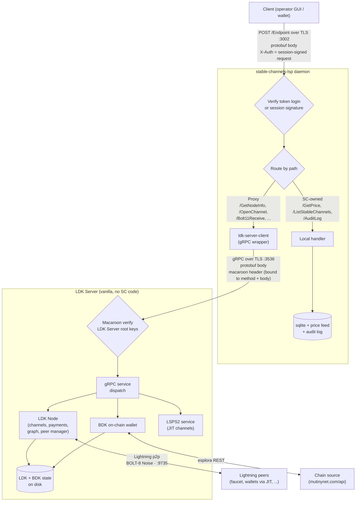

# server/

Cargo workspace for the **Stable Channels LSP** bidaemon architecture, under active development.

## Architecture



`stable-channels-lsp` proxies node-level calls to LDK Server over gRPC and serves SC-specific data (price feed, stable channel records, audit log) directly. LDK Server stays vanilla.

### Clients

Two parallel client classes talk to the SC daemon's REST API:

- **Operator GUI** (`lsp-server-gui`) for admin tasks: channel management, on-chain funds, audit log.
- **Wallet apps** (desktop, iOS, Android) for end-user receive/send.

They are **peers, not chained**. Both are equal clients of the same REST surface. The operator GUI is not "in front of" the wallet apps.

### Auth model

Each connection (client → SC daemon, *and* SC daemon → LDK Server) is secured by three pieces of provisioning data:

| Item | Role |
|---|---|
| **API URL** | Where the listener is (`https://127.0.0.1:3002` for the SC daemon, `127.0.0.1:3536` for LDK Server gRPC). |
| **Client credential** | Hop 1 (SC daemon): an LDK Server token (macaroon) at login, then a per-session signed request: the login returns a session secret, and each later request is signed with it in the `X-Auth` header. Hop 2 (LDK Server): a macaroon; for every request the client adds a caveat binding a copy to the RPC method, body hash and time, and sends that copy in the `macaroon` header. **Requests carry only signatures or bound copies; a GUI token itself crosses the wire (inside TLS) only at login.** This is what authenticates the **client to the server**. |
| **TLS certificate** | The server's self-signed cert, **pinned** by the client. Authenticates the **server to the client** and encrypts the channel. |

So three jobs, three mechanisms: the session signature or bound macaroon proves who's calling, cert pinning proves who's answering, TLS encrypts the bytes in between.

The two hops have **separate TLS certs but one token system**: every token is an LDK Server macaroon.

- Hop 1 (client → SC daemon): an LDK Server token (then its session secret) + the SC daemon's TLS cert.
- Hop 2 (SC daemon → LDK Server): the daemon's own LDK Server token + **LDK Server's own** TLS cert.

**What a leaked token reaches: its permissions, on both servers.** A GUI token is an LDK Server token, so besides logging into the SC daemon (whose own routes are checked against the same LDK permission names) it works directly against LDK Server's gRPC wherever that port can be reached. The other way round, any LDK Server token restricted only by permissions and an expiry can log into the SC daemon (tokens limited to single methods are refused at login). An `admin` token can read every channel and payment on the node, wallets' node ids included, and can move funds. A leaked session secret is worth only that session, until it ends (logout, revoke, daemon restart or its 12-hour limit). After a leak, revoke the token on the GUI's Access page: LDK Server stops accepting it and the daemon ends its sessions at once (after a revoke with LDK Server's own command line, they end within about 30 seconds).

The daemon's own token is separate from GUI logins: the Access page refuses to revoke it, since that would stop stability payments. To replace it, make a new one with LDK Server's own tools, point the daemon at it and restart the daemon (see below).

**GUI admin token and remote desktop GUIs**: once LDK Server answers, the daemon keeps a working admin token for the first GUI login in `<storage_dir>/<network>/gui.macaroon` (hex, mode 0600; `<storage_dir>` is the daemon's `[storage.disk] dir_path`). It makes a new one when the file is missing or refused, and at once when that token is revoked on the Access page. A desktop GUI on the same machine reads it from there. For a desktop GUI on another machine, copy the token (`gui.macaroon`, or better a limited token made on the Access page) and the daemon's `<storage_dir>/tls.crt` to it over a secure channel, and enter them as the GUI's access token and TLS cert path. The daemon's `[tls] hosts` must name the address that GUI dials; the daemon writes its certificate only when none exists, so after changing `[tls] hosts` delete `tls.crt` and `tls.key`, restart the daemon and give every client that pinned the old certificate the new one.

**How the SC daemon obtains LDK Server's secrets**: at startup the SC daemon reads LDK Server's own config file (path set in `sc-config.toml` under `[ldk_server] config_path`), derives the TLS cert path and `<storage>/<network>/macaroons/admin.macaroon` from it, and loads both into memory. `[ldk_server] macaroon_path` points it at a different macaroon instead. A macaroon without a permission breaks whatever needs it: the daemon's own stability, SYNC and refund keysends, message signing and verification, channel and payment reads and the event stream, and also the operator GUI's actions: GUI sessions get at most its permissions, GUI logins need it to have `macaroons:manage`, and only an unrestricted `admin` token can make `gui.macaroon`. The daemon reads the macaroon only at startup, so restart it after replacing the file. Both daemons need read access to a shared filesystem, usually the same host (Umbrel, VM, etc.). To split them across hosts, those two files have to be shipped over a separate secure channel, or the transport upgraded to mTLS.

## Crates

| Crate | Source | Role |
|---|---|---|
| `stable-channels-lsp/` | local | The daemon. axum REST server, token login and session-signed auth, `ldk-server-client` wrapper. |
| `sc-protos/` | local | Hand written `prost` types for SC specific REST endpoints, plus route path constants. |
| `sc-rest-client/` | local | REST client library, linked into the GUI and consumed by mobile wallet apps. WASM compatible. |
| `lsp-server-gui/` | local | Native (Dioxus desktop) + WASM (Dioxus web) operator GUI. Talks to `stable-channels-lsp` over REST. |
| `ldk-server-client` | LDK Server (`lightningdevkit/ldk-server`) | gRPC client used by `stable-channels-lsp` to dial LDK Server. Pinned to upstream via cargo git rev. |
| `ldk-server-grpc` | LDK Server (`lightningdevkit/ldk-server`) | Wire types for LDK Server's gRPC surface (`GetNodeInfoRequest`, `Channel`, etc.). Pulled in transitively via `ldk-server-client`. |
| `stable-channels` (root crate) | local | Shared utility lib (`db`, `audit`, `price_feeds`, `constants`). Path dep'd by the daemon. |

### Operator GUI builds

The GUI is a Dioxus app with two targets that share one codebase and stylesheet (`lsp-server-gui/assets/app.css`, light and dark themes).

- **Desktop:** `cargo run --release --locked -p lsp-server-gui`. On Linux, install the webview toolkit first: `sudo apt install libwebkit2gtk-4.1-dev libgtk-3-dev libxdo-dev libsoup-3.0-dev libjavascriptcoregtk-4.1-dev`. Native file dialogs go through the XDG desktop portal (`xdg-desktop-portal`). macOS and Windows 10/11 need nothing extra.
- **Web (WASM):** `server/lsp-server-gui/web/build.sh` writes a static bundle to `server/lsp-server-gui/dist/`. It needs `rustup target add wasm32-unknown-unknown` and a `wasm-bindgen-cli` matching the `wasm-bindgen` version in `Cargo.lock` (the script prints the exact `cargo install` command). Serve `dist/` behind a reverse proxy that forwards `/api/` to the SC daemon, as `umbrel/docker/Dockerfile.lsp-gui` does.
- **Tests:** `cargo test -p lsp-server-gui --locked`.

## Run the stack on Mutinynet (signet)

[Mutinynet](https://mutinynet.com/) is a public signet variant with ~30s blocks and a faucet at <https://faucet.mutinynet.com/>. It's the recommended way to bring up the full stack (LDK Server + SC daemon + operator GUI + desktop wallet) end to end without spending real bitcoin. The setup is **four terminals**. All commands assume `bash`/`zsh`.

### 1. Clone both repos

```bash
git clone https://github.com/toneloc/stable-channels.git
git clone https://github.com/lightningdevkit/ldk-server.git
git -C ldk-server checkout aa2d60f51ebacc7edd5dbdfb90b53a9c73ee0bd3
```

They can live anywhere on disk in any layout. Cargo pulls `ldk-server-client` from upstream at a pinned rev, so no sibling-directory requirement. Run LDK Server at that same rev (the `ldk-server-client` rev in `server/stable-channels-lsp/Cargo.toml`): the daemon and LDK Server must speak the same protobuf format.

### 2. Configure LDK Server

In `ldk-server/contrib/ldk-server-config.toml`:

```toml
[node]
network = "signet"
# The SC daemon backfills missed forwards from LDK Server's detailed history (about the last two hours); the default "stats" keeps only totals.
forwarded_payment_tracking_mode = "detailed"

[esplora]
server_url = "https://mutinynet.com/api"

[liquidity.lsps2_service]
channel_opening_fee_ppm      = 0
min_channel_opening_fee_msat = 0
min_payment_size_msat        = 1000000

[tor]
proxy_address = "127.0.0.1:9050"
```

This field requires the pinned `aa2d60f5` LDK Server above; older Umbrel-pinned
images reject it. Upgrade LDK Server and the SC daemon/client in lockstep and
back up current configs and node data before changing versions. On rebuilt
Umbrel images, the LDK image's entrypoint adds the key only if absent, preserving
explicit operator choices (including `"stats"`). The host hook deliberately does
not add it for older images. See [Umbrel's version-safe migration instructions](../umbrel/README.md#detailed-forwarded-payment-history-and-version-compatibility)
for writable directory mounts, manual migration and downgrade requirements.
Detailed tracking starts collecting forward records when enabled; it does not
recover stats-only history or records older than LDK's retention window.

LDK Server's LSPS2 channel-opening fee is configured here. The current Stable
Channels prod-parity value is `channel_opening_fee_ppm = 0`, with
`min_channel_opening_fee_msat = 0`, so JIT channel opens do not add an LSP
opening fee. Lightning routing fees are channel config, not startup LSPS2
config: `forwarding_fee_base_msat` plus
`forwarding_fee_proportional_millionths`, set when opening a channel or via
`UpdateChannelConfig`. LDK's ordinary channel default is `1000 msat` base and
`0` proportional; LSPS2 JIT channels currently set both forwarding fees to `0`.
Stable-channel buy/sell trades separately use a 1% client-side trade fee
(`STABLE_CHANNEL_TRADE_FEE_RATE`) sent to the LSP as the TRADE_V1 keysend
amount.

For the LdkLog route to return content, set `[log] file = "/some/path/ldk-server.log"` in the same config so a file exists to tail.

Comment out the `[bitcoind]`, `[electrum]`, and `[[liquidity.lsps_client]]` blocks. The `[tor]` block must stay uncommented even if Tor isn't running.

### 3. Configure the SC daemon

```bash
cd stable-channels
cp server/stable-channels-lsp/example-config.toml ./sc-config.toml
```

Edit `sc-config.toml`:

```toml
network = "signet"
config_path = "/absolute/path/to/ldk-server/contrib/ldk-server-config.toml"
```

`config_path` is how the SC daemon discovers LDK Server's TLS cert and admin macaroon. LDK Server creates `admin.macaroon` on its first start, so start it before the daemon.

For push notifications, add an optional `[push]` section with `apns_*` and `fcm_service_account_path` fields. Each is optional. Missing credentials disable that sender and log a warning at startup, but `RegisterPush` keeps working. See `server/stable-channels-lsp/example-config.toml` for the full schema.

### 4. Configure the desktop wallet

In `stable-channels/src/constants.rs`:

```rust
pub const DEFAULT_NETWORK: &str = "signet";
pub const DEFAULT_CHAIN_URL: &str = "https://mutinynet.com/api";
pub const FALLBACK_CHAIN_URL: &str = "https://mutinynet.com/api";
pub const DEFAULT_LSP_PUBKEY: &str = "<LSP_NODE_ID>";   // fill in after step 5
pub const DEFAULT_LSP_ADDRESS: &str = "127.0.0.1:9735";
```

`<LSP_NODE_ID>` comes from LDK Server's startup log line `Starting up LDK Node with node ID ...`. Launch the LSP first (step 5, terminal 1), copy the ID, paste it here, then build the wallet (terminal 4).

### 5. Launch the four services

```bash
# Terminal 1: LDK Server (LSPS2 service feature is required for JIT channels)
cd /path/to/ldk-server
cargo run --release -p ldk-server --features experimental-lsps2-support -- contrib/ldk-server-config.toml

# Terminal 2: SC daemon
cd /path/to/stable-channels
cargo run --release -p stable-channels-lsp -- sc-config.toml

# Terminal 3: Operator GUI (Linux: see "Operator GUI builds" for the webview packages)
cargo run --release --locked -p lsp-server-gui

# Terminal 4: Desktop wallet (after pasting the LSP node ID into src/constants.rs)
cargo run --release --bin stable-channels
```

First builds take a few minutes. Subsequent runs are seconds.

### 6. Run the full Lightning flow

In the operator GUI, then the wallet:

1. **Load Config** → **Connect** (status turns green).
2. **Onchain** tab → **Get Address** → copy the `tb1q...` address.
3. <https://faucet.mutinynet.com/> → on-chain section → paste address → request ≥ 100,000 sats → wait ~1 block.
4. The faucet's Lightning node URI is in the form `<pubkey>@<host:port>`. As of writing:
   - **Node ID (pubkey):** `02465ed5be53d04fde66c9418ff14a5f2267723810176c9212b722e542dc1afb1b`
   - **Address:** `45.79.52.207:9735`

   If the faucet has rotated keys since, grab the current values from the faucet site.
5. **Channels** tab → Connect Peer → paste the Node ID and Address from step 4 → **Connect**.
6. **Channels** tab → Open Channel → same Node ID and Address, channel amount `50000` sats → **Open Channel** → wait ~90s for `is_channel_ready = true`.
7. **Lightning** tab → **Spontaneous Payment (Keysend)** → Recipient = faucet Node ID, Amount = `30000000` **msat** (= 30,000 sats, multiply sats by 1,000 since the field is in msat) → **Send**. This pushes sats to the faucet's side of the channel so the LSP has inbound capacity.
8. In the **wallet** onboarding screen: **Add Bitcoin** → **Fixed amount** (use Fixed on Mutinynet, enter ≥ 1000 sats) → **Receive**.
9. Copy the `lntbs1...` invoice from the wallet's QR screen.
10. Faucet site → Lightning section → paste invoice → **Pay**.
11. The LSP opens a JIT channel to the wallet on the fly and forwards the HTLC. Verify in the operator GUI: **Channels** now shows two channels (faucet + wallet), and **Forwarded Payments** shows the routed HTLC. The wallet balance updates.

### Other networks

For regtest or mainnet, the same shape applies: swap `network = "signet"` in both config files, swap the esplora URL (or activate `[bitcoind]` / `[electrum]` instead) in LDK Server's config, and update `DEFAULT_CHAIN_URL` + `FALLBACK_CHAIN_URL` in `src/constants.rs`. Drop the zero-fee LSPS2 values when you're not just testing.
